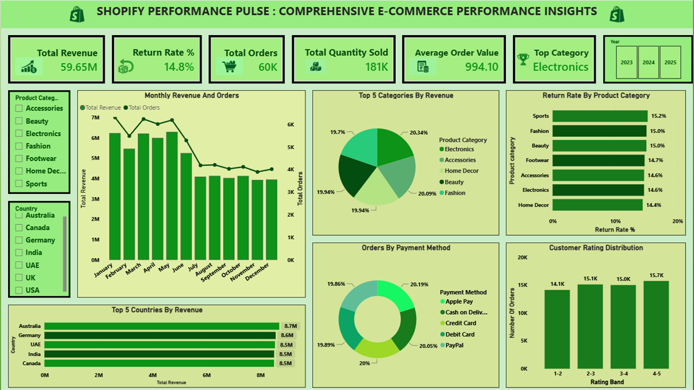

# Shopify Performance Pulse – E-commerce Performance Analysis

## 1. Project Overview

Shopify Performance Pulse is an e-commerce sales analytics project developed using Microsoft Power BI.

The project analyses sales performance, revenue trends, product category contributions, customer ratings, payment methods, geographical performance and product returns.

An interactive dashboard was developed to transform sales data into meaningful business insights and support data-driven decision-making.

## 2. Business Objectives

- Monitor overall e-commerce revenue and sales performance.
- Analyse monthly revenue and order trends.
- Identify top-performing product categories.
- Evaluate product return rates across categories.
- Understand geographical revenue distribution.
- Analyse customer payment preferences.
- Explore customer rating patterns.
- Identify opportunities to improve business performance.

## 3. Dataset Overview

The project uses an e-commerce Shopify dataset covering **2023–2025**.

The dataset supports analysis across:
- Sales and revenue
- Orders and quantities sold
- Product categories
- Geographical markets
- Payment methods
- Product returns
- Customer ratings

## 4. Tools and Technologies

**Primary Tool:** Microsoft Power BI

**Techniques Used:**
- Data Cleaning and Transformation
- Power Query
- Data Modelling
- DAX Measures
- KPI Development
- Interactive Dashboard Design
- Data Visualization
- Slicers and Filters

## 5. Dashboard Preview

## 6. Key Performance Indicators

| KPI | Dashboard Result |
|---|---:|
| Total Revenue | 59.65M |
| Return Rate | 14.8% |
| Total Orders | 60K |
| Total Quantity Sold | 181K |
| Average Order Value | 994.10 |
| Top Category | Electronics |

## 7. Dashboard Components

### 7.1 Monthly Revenue and Orders
Visualises monthly revenue and order trends to understand sales performance over time.

### 7.2 Top 5 Categories by Revenue
Highlights the revenue contribution of the leading product categories.

### 7.3 Return Rate by Product Category
Compares product return rates to identify categories with relatively higher return percentages.

### 7.4 Orders by Payment Method
Analyses order distribution across different payment methods, including Apple Pay, Cash on Delivery, Credit Card, Debit Card and PayPal.

### 7.5 Customer Rating Distribution
Examines the distribution of customer ratings across different rating bands.

### 7.6 Top 5 Countries by Revenue
Identifies the leading geographical markets based on revenue contribution.

## 8. Key Business Insights

- Total revenue stands at 59.65M, with 60K orders recorded.
- Electronics is the leading product category.
- Australia records the highest revenue among the countries displayed, at approximately 8.7M.
- Sports has the highest category-level return rate at 15.2%.
- The overall product return rate is 14.8%.
- Monthly revenue and order trends show variations throughout the year.
- Customer ratings are
